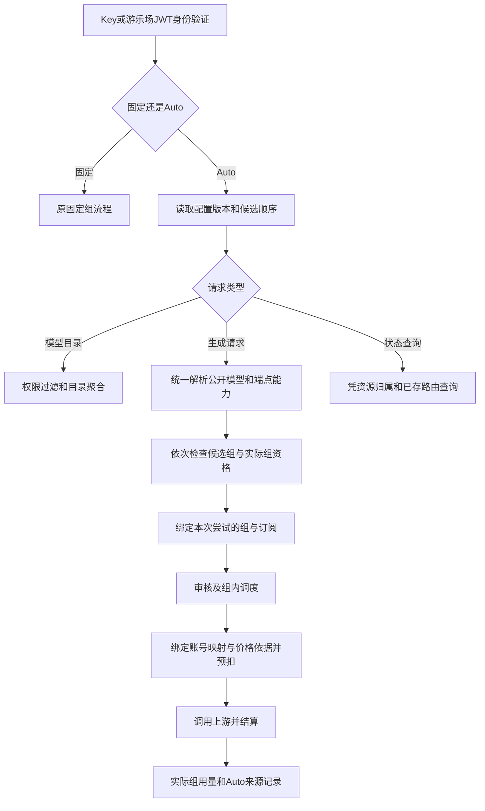

# Auto 分组实施方案（源码审查修订版）

状态：第一阶段已在本地实现，尚未提交、发布镜像或部署。实施日期：2026-10-16。下方详细方案包含后续阶段目标，当前交付边界以本节为准。

## 当前实现与使用方式

1. 管理员在「Auto 分组」创建配置，选择已有真实分组并排序。新配置默认停用，检查候选范围后编辑启用。Composite 组不能作为候选。
2. 用户在 API Key 的 Auto 路由设置中选择配置，可继承管理员顺序，或从本人有权使用的候选组中选择、排序。当前先创建普通 Key，再切换 Auto；不改变已有固定分组 Key 的行为。
3. 游乐场聊天和工作流可选择 Auto 配置；游乐场使用独立的服务端 Key 绑定，不复用用户同名 Key。对话历史保存所选配置。模型列表按端点能力区分聊天、文生图和图生图。
4. 请求在发送上游前确定实际分组，使用该组的权限、内容审查、订阅、账号调度和扣费链路。用户全局 RPM 和用户×实际组 RPM 共同限制。用量记录保留实际组及 Auto 配置、版本、尝试次数。
5. 配置更新要求版本号；固定组与 Auto 来回切换时版本保持递增。已撤销权限的候选不再使用；自定义候选全部失效时返回错误，不隐式改成继承顺序。
6. 已开始发送的请求不跨组重试；执行状态持久化并在发送前竞争唯一执行权。组内账号故障切换仅复用本次请求已经准入的执行权，每次派发前保存当前账号及倍率快照，结算使用最终实际账号；不得在完成、收到结果证据或请求身份变化后复用。RPM 准入在实际派发边界执行，排队、选择账号或保存快照失败不消耗 RPM。确定没有调用上游时，在事务中释放执行权，保留同一请求的重试机会；已发送但结果不明时禁止重放。图片结果不明时保留预留款，待核对，避免重复生成或无依据退款。

### 第一阶段边界

- 支持 HTTP Chat Completions、Responses、Messages、同步图片生成及编辑。Auto 不支持原生 Gemini 路由、WebSocket、Codex 模型清单、`previous_response_id`、异步图片资源和 Responses 内置生图工具；固定组原有能力保留。
- Antigravity 分组可通过现有兼容转发链处理 HTTP `/v1/responses`；Gemini 分组暂不声明 Responses 能力，避免混合调度选中不支持该端点的原生 Gemini 账号。仍需满足用户授权、分组模型白名单和 Claude Code 限制。Auto 提前拒绝请求时也记录已解析的模型名；尚未选定分组时平台留空，不再根据 `/v1/responses` 等入站路径推断上游供应商。
- 模型目录按当前授权候选合并模型、平台与端点能力；尚未提供按来源组展示的价格区间、部分目录失败降级。源目录读取失败会返回错误。
- 管理员可在 Auto 配置中开启「模型列表筛选」，每行填写目录中的模型名或 `*` 通配模式，例如 `gpt-5.5`、`claude-*`、`gemini-*`。大小写不敏感，客户端 `/v1/models`、单模型目录与游乐场只显示真实授权目录中匹配的原始模型 ID；不会凭规则新增模型或展开目录中不存在的 `-thinking` 别名。规则按填写顺序输出并去重。该开关只影响目录展示，直接请求的权限、路由和实际组计费仍沿用原规则。
- 实际组配置、用户倍率、账号倍率和定价时刻写入请求/派发快照；渠道映射与基础模型单价继续使用现有计费解析器，不承诺所有全局价格配置在整个请求期间冻结。
- 执行防重基于服务端请求 ID，不能将客户端使用新请求 ID 再次提交视为同一次请求。已完成请求不缓存/重放输出。
- 未提供结果不明预留款的专用核对界面；上线前应确认现有账务排查流程。当前没有在线生产验收结果。

### 本地验证

后端使用仓库要求的 Go 1.27.2；可运行 `GO_BIN=/path/to/go GOPROXY=off bash tools/verify-auto-routing.sh` 和 `bash tools/verify-community.sh`。前端使用已有 pnpm 环境运行类型检查、专项测试和生产构建。

迁移验证脚本 `tools/verify-auto-routing-migration.mjs` 使用独立 PGlite 实例，不连接业务数据库。将 `@electric-sql/pglite` 安装到临时目录后，设置 `PGLITE_MODULE` 为其 `dist/index.js` 的绝对路径并运行 `node tools/verify-auto-routing-migration.mjs --full-schema`。覆盖全量迁移、重复迁移、固定/Auto 切换、版本递增、错误绑定约束、唯一执行记录、组内账号快照切换与终态保护。该验证运行 PostgreSQL WASM 引擎，不代替原生 PostgreSQL 多连接并发与整站端到端验收。

目标仓库：`yunyar/sub2api`，本地 `work/sub2api-custom-playground`，基线 `1d6e92a7b3d1bdc162a806a4064bd4bc1ffa7fab`。当前游乐场图片格式修复是独立的未提交变更，不是 Auto 实现或线上故障已彻底解决的证明。

## 1. 目标与必须修正的旧方案

管理员创建名为 Auto 的自动分组入口；用户选择有权使用的真实分组并排序；获取模型时汇总这些分组的模型；发起请求时按模型、端点及分组顺序选实际分组，采用实际分组的审核、权限、调度和计费规则。API 客户端及游乐场都应支持。

旧方案方向可用，但不能直接照写：

| 旧说法 | 修订 |
| --- | --- |
| 在现有鉴权之后加分组解析即可 | 当前鉴权已经做了分组、订阅和余额检查；Auto 必须拆开身份验证与实际组资格检查 |
| Auto 只存 API Key 的一个模式即可 | 还需要管理员可创建的路由配置、候选组范围与默认顺序，才能兑现“创建 Auto 分组” |
| 模型合并后都能用同一接口调用 | 目录必须携带能力信息，路由还要检查端点兼容；不增加隐式协议转换 |
| 请求只解析一次实际组，同时允许切组 | 请求策略快照固定，每次尝试独立绑定实际组；开始执行后的切组有严格条件 |
| 所有超时、5xx、限流都可跨组重试 | HTTP 状态不能证明未执行；未知结果不能自动重发，图片尤其如此 |
| 失败切组后只按最后一组扣费 | 仅对已确认无可计费用量的失败尝试成立；不能丢掉已产生的部分输出与费用 |
| 幂等键加入分组即可 | 保持原请求幂等作用域，组是执行证据；改组不能变成新的扣费身份 |
| 增加另一套 effective_group_id 日志字段 | 现有 usage_logs.group_id 就保存实际组；新增 Auto 来源字段即可，避免双字段分歧 |
| 所有供应商、WebSocket、异步任务一起上线 | 按端点登记能力和验收；未完成的 Auto 端点明确拒绝，固定 Key 保持原行为 |

## 2. NewAPI 核对依据及可借鉴部分

参考仓库 `https://github.com/QuantumNous/new-api`；本地核查快照 `7209b6db95ef33bfb0f6344ebf61c1fec9af780c`，不是对远端最新提交的声明。

| 源文件 / 符号 | 已核对行为 |
| --- | --- |
| `model/token.go`: Token / GetAutoGroups / SetAutoGroups | Group=auto，有序 AutoGroups，独立 CrossGroupRetry |
| `controller/token.go`: setTokenAutoGroups | 保存时检查数量、分组权限；更新字段有省略与清除语义 |
| `service/group.go`: GetRequestAutoGroups / FilterUserTokenAutoGroups | 请求时重新过滤权限；明确候选全部失效时不暗中改用全局组 |
| `service/group.go`: GetGroupsEnabledModels | 按候选组顺序汇总启用模型并去重 |
| `controller/model.go`: getModelListGroups | Auto 模型列表使用候选组，而非固定单组 |
| `service/channel_select.go`: CacheGetRandomSatisfiedChannel | 找不到可用渠道时继续下一组，不受CrossGroupRetry开关限制；已选渠道失败后的跨组重试是另一种流程，由开关与重试状态共同控制 |
| `relay/helper/price.go`: HandleGroupRatio | 通过 auto_group 更新 UsingGroup 并计算实际组倍率 |

采用这些产品语义，不复制整套 NewAPI 渠道调度。Sub2API 使用整型分组 ID、组内账号调度、独立订阅和图片预扣，需要自己的适配层。NewAPI 自定义候选列表与全局列表的关系，也不等于本方案的管理员白名单；这里明确要求用户候选是管理员允许范围与用户权限的交集。

可复核的官方固定提交源码：[候选组与模型聚合](https://github.com/QuantumNous/new-api/blob/7209b6db95ef33bfb0f6344ebf61c1fec9af780c/service/group.go)、[渠道与跨组选择](https://github.com/QuantumNous/new-api/blob/7209b6db95ef33bfb0f6344ebf61c1fec9af780c/service/channel_select.go)、[模型目录](https://github.com/QuantumNous/new-api/blob/7209b6db95ef33bfb0f6344ebf61c1fec9af780c/controller/model.go)、[实际组倍率](https://github.com/QuantumNous/new-api/blob/7209b6db95ef33bfb0f6344ebf61c1fec9af780c/relay/helper/price.go)。

## 3. Auto 与现有 Composite 的关系

现有 Composite 自身是一个真实分组：访问权限与订阅属于该组，模型解析选出具体 provider，平台配额与渠道定价按该 provider 处理，组倍率和账单 group_id 仍属于 Composite；详见 [COMPOSITE_GROUPS.md](COMPOSITE_GROUPS.md)。Auto 是在多个已有真实分组间选择，并使用被选组的费率。这两个概念不能合并，也不能把账号从原分组复制到 Auto 来代替跨组计费。

UI 将 Auto 展示为“自动分组”，数据库用独立路由配置表示。不要创建 `platform=auto`，不要伪造负数 group_id，不要让未解析的 Auto 走现有无分组账号池。

首期 Auto 候选只接纳已通过端点适配测试的真实非 Composite 分组。后续允许 Composite 候选时，顺序是 Auto 选真实 Composite 组，再复用其 provider/model 解析；账单仍属于被选 Composite 组，不反推账号原来属于哪个普通组。

## 4. 数据结构与编辑语义

下列是拟新增结构，不代表当前已有字段。

- `auto_group_profiles`：id、name、status、revision、max_candidates、allow_custom_order、cross_group_retry_allowed、model_catalog_filter。筛选字段为 JSONB `{enabled:false, models:[]}`，默认关闭；开启时列表不可为空。迁移 `248` 给旧配置补充关闭状态；旧客户端更新省略该字段时保留已存规则，修改仍受 revision 并发控制。结构允许创建多个 Auto 配置。
- `auto_group_profile_members`：profile_id、group_id、sort_order。确定允许范围与默认顺序；唯一约束 `(profile_id, group_id)` 和 `(profile_id, sort_order)`，反查索引 group_id。
- `api_keys`：routing_mode（默认 fixed）、auto_profile_id（可空）、auto_selection_mode（inherit/custom）、cross_group_retry（默认 false）、routing_revision。
- `api_key_auto_groups`：api_key_id、group_id、sort_order；唯一约束 `(api_key_id, group_id)` 和 `(api_key_id, sort_order)`，反查索引 group_id。
- `playground_auto_key_bindings`：user_id、profile_id、api_key_id；`(user_id, profile_id)` 唯一，api_key_id 唯一并外键引用 api_keys。服务端验证 Key 的 user/profile 与绑定一致；专用 Key 的停用/替换在事务内维护绑定，不与同名普通 Key 混用。
- `auto_route_executions`：以 `(api_key_id, request_id)` 唯一；保存payload_hash、profile/revision、候选快照、状态、当前attempt、实际组及账单快照引用、upstream请求/任务标识（如有）、结算状态与时间戳。
- `auto_route_attempts`：execution_id、attempt_no 唯一；保存实际组、状态、账号/平台、配置/定价快照、预留引用、派发及结果证据。不得保存API密钥或原始文件；成功结果是否可恢复由协议决定，不为幂等默认永久保存用户输出。

数据库不变量：fixed 时 auto_profile_id 为空，group_id 延用原有可空语义；auto 时 auto_profile_id 非空、持久化 group_id 为空。Auto 的空 group_id 必须由新路由模式显式处理，绝不能当成旧式未分组 Key。候选和排序在单事务内整体替换；更新带 revision，冲突返回 409。

继承模式按管理员默认顺序与当前用户权限取交集；自定义模式必须显式提交非空、有序候选列表。重复组、超过上限、越权组直接返回校验错误，不悄悄删除后成功。更新省略字段保持原值，切换 inherit 显式提交模式并清除自定义关联；custom+空列表拒绝。运行时撤权可过滤候选，但过滤为空时禁止回落继承或固定分组。

管理员改名不会改变路由身份。停用配置使新请求失败；删除采用软删除/禁用，保留历史引用。有活跃 Key 或在途任务时不物理级联删除证据。候选只引用真实 groups，不能套用另一个 Auto，避免环。

## 5. 请求生命周期与接入点

1. 从 `api_key_auth.go` 提取可复用的身份与 Key 级检查、实际组授权与订阅检查两个阶段，同时覆盖 Google 专用鉴权。保留 IP ACL、用户状态、Key 额度/过期、Simple 模式、usage/billing/已完成任务查询的现有特殊语义。
2. 对 Auto，在实际组相关校验前做请求分类与模型读取。模型目录没有单个实际组，不能硬塞候选第一组再调用旧 handler。
3. 复用 `internal/pkg/requestmodel` 与已有 body preread，保留上传体限制、JSON/multipart/Gemini URL 语义。大小写变体、重复 model、session.model 与顶层 model 不一致时拒绝歧义，不能解析器选 A 而下游发 B。
4. 候选过滤顺序：profile 许可、用户可绑定权限/有效订阅、group 状态、公开模型白名单、模型支持、端点能力、可调度账号。不能靠前缀猜测或存在价格就证明可调用；复用现有模型映射和账号能力规则。目录失败/查询错误不能等同于不支持模型。
5. 选中实际组后，完成该组的订阅、余额、RPM、平台配额及权限检查。额度耗尽不默认转到更贵的余额组；用户级余额不足、Key 限额、审核拒绝均终止。订阅过期导致候选失去授权可跳过，但已授权订阅额度耗尽默认明确报错。
6. 生成请求在进入 `GroupModelAllowlist`、Composite/平台分发与 handler 前，绑定实际组；再次白名单检查保留纵深验证。RequireGroupAssignment 仅对明确已解析的 Auto 放行，未完成解析直接拒绝；不能放宽普通未分组 Key 的限制。
7. HTTP 的 endpoint/source metadata 与响应错误格式沿用现有协议，不把 OpenAI 错误格式统一强加给 Gemini/Anthropic。

Simple 模式必须保留当前提前返回语义：校验身份、用户/Key停用状态、候选组状态与授权；不把标准模式的订阅额度、余额、Key到期/额度检查强行前移到它之前。既有Simple专用Key限速计费开关仍沿原路径处理。组的可绑定授权与消费资格是两个问题，不能因跳过收费就开放未授权组。

候选容量探测不占用账号槽位，真正调度与释放由现有 handler 负责。探测后容量变化仍可能导致选组失败，只能在未执行边界内重新编排。上图是依赖顺序，不要求把所有 handler 的“预算预留→账号槽位申请”顺序反转；可先按实际组做保守估算，选账号后补齐映射与计价依据，在调用上游前冻结本次结算规则。

`CheckBillingEligibility` 内的 RPM 检查有递增副作用，必须拆成只读资格预检和幂等准入计数：用户级计数按逻辑请求一次，组级计数仅在该组实际派发时按尝试一次；重入不再计数，跳过候选不计数。保留当前并行限制语义：用户全局上限始终生效，用户×组override只替代组上限，override=0也不免除全局上限；计数实际键是user×group，不误改为全组所有用户共享桶。在Redis原子脚本或等价实现中校验限制并登记计数标记，不用普通GET后INCR拼接；Redis故障策略与现有固定Key策略兼容，另加可观测性。额度预留、用户槽位、账号槽位各自只有一个明确owner和释放路径。

建议两层上下文：请求级 `AutoRoutingPlan` 固定原 Key ID、用户、profile/revision、候选顺序、原模型与端点；尝试级 `EffectiveGroupContext` 固定实际组、组配置、订阅、用户×组倍率/RPM 和平台。选账号后再生成 `BillingExecutionSnapshot`，纳入实际账号、channel、映射、计费模型策略、定价时刻和价格依据。不要在尚未选择账号时伪称已确定全部账号价格。

兼容现有 handler 的桥接方式：创建请求专属 APIKey/User/Group 副本，将 GroupID/Group 和用户组 RPM override、订阅上下文、ctxkey.Group、Ops fallback 同步更新。嵌套 map/slice 按需深拷贝或只读封装；禁止改认证缓存共享指针。异步用量 worker 显式接收快照，不能依赖已经释放的 Gin Context。

## 6. 模型目录、排序与价格展示

先定义统一的 `ListGroupModelCapabilities` / `ResolveGroupModelCapability`，抽取现有目录/调度共享逻辑，不在服务端循环调用 HTTP `/models` handler，不为每次用户请求实时探测所有上游。

- 目录表示配置与能力，不随每次账号并发满载闪烁。短时可用性在实际调度时检查。
- `/v1/models` 返回所选授权组支持模型的并集和稳定排序，继续使用兼容的 OpenAI models 响应格式。Gemini 原生目录返回对应协议模型；Codex manifest 另有能力结构，不能当普通 models JSON 混用。
- 面板使用扩展目录：`model_id`、`capabilities`、`supported_endpoints`、可见的来源组、首选组及费用说明。能力为 chat/images/image_edit 等；游乐场不再只凭名称含 image 猜测图片能力。
- 同名模型有可互换的调用能力时，合并模型名并按用户组顺序选择；价格不同不需要强制改名，只需显示费用随实际组变化。
- 同名且语义冲突时提供管理员显式别名映射，可固定到组与端点；不在前端任意给所有模型加供应商前缀。别名、公开模型、路由模型和计费模型分别保留，审核与白名单检查顺序明确，防止别名绕过。
- 某组目录读取失败时，面板标明目录不完整和该组异常；兼容接口可返回已验证子集并附响应状态头。所有源查询失败返回 503，真实的无授权模型返回空目录/请求模型 404，不能混为同一种失败。
- 价格展示复用服务端价格解析，含用户倍率、图片倍率和高峰时段；显示估价和备选价范围，不把一个固定 Auto 倍率当最终价格。

## 7. 重试与费用一致性

首期提供“未执行时自动选下一组”，跨组重发默认关闭。组内沿用既有账号选择机制，但 Auto 场景必须约束现有跨组 fallback_group_id / fallback_group_id_on_invalid_request，不能绕出用户候选范围；建议首期 Auto 下禁用旧跨组 fallback，由统一编排负责。

| 状态 | Auto 行为 |
| --- | --- |
| 不支持模型/端点、组停用/撤权、未发出上游请求且无可用账号 | 跳过该候选，继续用户顺序 |
| 用户余额或 Key 总额/RPM 等全局限制不满足 | 终止，禁止通过切组绕过 |
| 已选组订阅额度或用户×组限额耗尽 | 首期终止；未来如允许另付费，必须有明确用户选项 |
| 审核拒绝、参数错误、权限错误 | 终止；不能以换组规避策略 |
| 可证明未执行且无计费用量的失败 | 开启跨组重试后可进入下一次尝试，释放原预留并重新校验/审核/预扣 |
| 超时、连接中断、普通5xx，无法确定是否执行 | 结果未知，停止自动跨组重发，不直接释放可能需要核账的持久化 hold |
| 已收到部分输出、已知 usage、任务ID，或已向客户端开始输出 | 不跨组重发；按已执行路径的既有规则处理结算/查询 |

HTTP 429/5xx 不是充分条件，重试分类必须由具体 adapter 提供执行状态证据。总尝试次数和总时限跨组共用，不重置组内计数造成乘法膨胀；继承请求取消，审查前及发送前检查 deadline。数据流式输出、JSON keepalive、图片部分结果均计入响应已开始的判断。

本次尝试一旦执行，实际组和费用归属固定。安全的下一次尝试使用新的上下文；已知有费用的尝试不能清零或挂到最终组。首期宁可保留现有组内行为并拒绝不安全的跨组重发，也不承诺“所有失败只收最后一组”。

## 8. 计费、图片 Hold、幂等与用量记录

复用现有计费服务，不另写一套 Auto 价格公式。实际组同时影响余额/订阅资格、用户组倍率、高峰倍率、图片独立倍率、channel/group/model 定价、RPM、平台配额、账号统计与最终用量。

必须覆盖两条结算链：`gateway_usage_billing.go` 和 `openai_gateway_usage.go`；只改其中一条会留下错账。对于 Composite 扩展，计费组 ID 与实际 provider 分开，QuotaPlatform 显式传入异步结算。

保留 Sub2API 的 requested/upstream/response billing-model 规则。Auto 不能把“按最终供应商返回模型计费”的既有配置粗暴改成只按请求模型；价格快照保存规则版本与必要数据，最终单位价格仍根据实际用量、尺寸和启用的计费模型策略计算。实时状态如余额/额度继续原子检查，不因快照而失去并发保护。

Playground 图片现有代码按 1K/2K/4K 中最大报价冻结，并非最终尺寸精确报价；这次 Auto 接入不暗改此收费口径。需要给持久化 hold 补充实际组、计费类型、价格依据版本、实际平台/模型、原 Key/request 与尝试身份。冻结、释放、结算和日志必须一致；待核账 hold 不能因超时自动退款。使用既有金额量化规范，不引入另一套浮点舍入。

保持扣费去重作用域 `(request_id, api_key_id)`。路由组/价格快照不成为一个可重扣的新 Key；同一请求重入要恢复执行记录或明确返回冲突，不能按新排序再执行一次。尝试 ID 只区分预留生命周期和审计，不允许一条成功结果重复结算。变更 fingerprint 使用版本化迁移策略，兼容已有去重和 hold 记录。

现有 `usage_billing_dedup` 只记录扣费 fingerprint，不等于生成请求的幂等执行记录。Auto 必须在上游派发前原子创建 execution/attempt：`prepared → dispatching → completed/failed/unknown`，用条件更新确保只有一个派发者。已标记 dispatching 后进程退出但没有结果证据的请求记 unknown，不以租约超时重新生成。已完成重入可返回可恢复任务/结果引用，否则返回明确已处理冲突；进行中返回进行中状态，payload不同返回409。实际扣费、hold终态与execution结算状态在同一数据库事务内推进，或通过持久化outbox保证可恢复一致性；不能扣费成功后只在内存标完成。

价格冻结还要检查 `apiKeyWithFreshGroupMediaPricing` 等补全路径及channel resolver：只允许在快照冻结前水合，结算时不可重新加载新组价格覆盖已接受的规则。存原始Key和实际组的区别必须在所有post-usage调用点有编译期参数或契约测试保证。

`usage_logs.group_id` 保存实际计费组；保留现有 APIKeyID、AccountID、SubscriptionID、RequestedModel、UpstreamModel、ChannelID、价格/倍率字段。最小新增 `routing_mode`、`auto_profile_id`、`routing_revision`、`route_attempt_count`；详细跳组原因放受限审计记录，避免大数组写入每条使用日志。无账号的路由失败走 Ops/审计，不伪造成功 UsageLog。

用户及管理员用量表均显示“Auto → 实际组”，按实际组过滤；按 Auto 来源筛选单独增加过滤项。不要把虚拟 Auto ID 塞进现有 group_id 外键破坏平台统计。

## 9. 游乐场与管理接口

现有 `playgroundAPIKeyBridge` 只接受正整数 `X-Playground-Group-ID`，`ResolvePlaygroundKey` 按 user+group 查找名为 Playground 的 Key；因此只改 KeysView 不会让游乐场支持 Auto。

新增 Auto 选择项和配置面板，候选多选、拖拽排序、显示模型能力与费用变化。面板不暴露 API Key 密钥。服务端维护用户+profile 的专用 Playground Auto Key：唯一归属关系/事务 upsert 保证并发首次访问不生成多个 Key，不能只依赖名称匹配。普通 API Key 和 Playground Auto 配置互相独立，UI 明确配置作用范围。

新增 `X-Playground-Auto-Profile-ID`，与原固定组头互斥；服务端用登录用户验证 profile/权限并解析持久化 Key，清理所有选择头后进入共同 Auto 链。严禁客户端直接指定未经校验的 effective_group。

聊天历史与 workflow schema 增加可选路由选择 `{mode, autoProfileId}`，固定模式保留原 groupId；更新 Redis 历史校验和前端类型，老记录缺字段按 fixed。同一会话可不同模型走不同实际组，每条消息记录执行归属；未完成请求不被后续排序修改影响。文件上传、图生图、并发发送都复用同一处理器。

以下为拟新增接口，实施时补 DTO、权限及路由契约测试：

| 接口 | 用途 |
| --- | --- |
| `GET/POST /api/v1/admin/auto-group-profiles` | 管理员列出/创建 Auto 入口 |
| `GET/PUT/DELETE /api/v1/admin/auto-group-profiles/:id` | 配置详情、版本化更新、停用/软删除 |
| `GET /api/v1/auto-group-profiles/available` | 用户可见 profile 和可选真实分组 |
| 现有 `POST /api/v1/keys`、`PUT /api/v1/keys/:id` | 原子提交 mode、profile、selection_mode、候选顺序、revision；无需再建重复排序接口 |
| `GET/PUT /api/v1/playground/auto-routing/:profile_id` | 读取/保存当前用户的 Playground Auto 配置 |
| `GET /api/v1/playground/models` | 沿用选择头，返回可扩展能力目录 |

Playground配置路由注册到独立的JWT用户路由组，仅做用户身份/配置权限检查；即使URL带playground前缀，也不能挂到现有带Key bridge的生成路由组，否则没有固定group头就会被拦截。只有models与生成请求走bridge。

不存在的旧方案文件名需纠正：用户 Key API 是 `frontend/src/api/keys.ts`；管理员使用记录页是 `frontend/src/views/admin/UsageView.vue`，不是 apiKeys.ts/UsageLogsView.vue。

## 10. 端点覆盖与分期

| 端点/能力 | 首期范围与约束 |
| --- | --- |
| `/v1/models`、Playground models | 模型并集；独立目录分支，不伪造第一实际组 |
| HTTP Chat Completions / Responses / Messages，含 SSE | 只支持已有 adapter 能处理的组与模型；带远端状态引用的请求另行限制 |
| 同步 images generations / edits | 仅当前已支持的平台、权限和请求格式；保持图片按张收费及审核 |
| Playground 普通对话和流程 | 与前述 HTTP 能力同批，包含 Auto 配置持久化与历史兼容 |
| Gemini generateContent / streamGenerateContent | 第二批，补 Google auth、URL模型、错误格式及 native models 契约后开放 |
| Embeddings / count_tokens | 第二批，按独立 endpoint 能力测试后开放，不从聊天兼容性推断 |
| Codex 专用模型 manifest | 第二批，合并/选取规范及客户端契约测试通过后开放；首期 Auto 明确不支持专用 manifest |
| WebSocket / Realtime / Live | 第二批；首帧模型晚于升级鉴权，专门适配。现有 Composite WS 模型变更需重连，不能声称已有逐回合自由切组 |
| previous_response_id 等远端状态引用 | 首期 Auto 拒绝有状态续接，要求显式完整上下文或固定 Key；第二批保存原组/账号绑定后续接 |
| 异步图片、batch、视频、文件、cached contents 资源 | 第二批；提交时保存实际路由，查询按资源归属定位，不能重新运行 Auto；未适配时拒绝 Auto 生成，固定 Key 原路径不变 |

具体能力验收表（均指拟接入Auto，现有路由存在不代表Auto已实现）：

| 入站端点 | 实际平台/adapter | 同步 / SSE | 状态续接及限制 |
| --- | --- | --- | --- |
| Chat Completions | OpenAI、Grok及 `UsesOpenAIGateway` 平台的Chat handler；Anthropic/Gemini/Antigravity的Gateway Chat转换路径 | 按模型/账号能力逐项验收 | 首期完整上下文；不新增协议转换 |
| HTTP Responses | OpenAIGateway Responses 或 Gateway Responses转换路径 | 按平台/模型逐项验收 | 首期拒绝previous_response_id；第二批仅开放已验证账号类型。当前OpenAI HTTP续接要求API-key账号，OAuth/SetupToken不等价 |
| Messages | Anthropic兼容路径；OpenAIGateway Messages桥接 | 原生/桥接分别验收 | 遵守AllowMessagesDispatch等组配置，不以model名字判定可桥接 |
| images/generations | OpenAI Images、GrokImages | 首期同步非SSE | 保留平台图片权限与模型能力 |
| images/edits | OpenAI Images编辑路径 | 首期同步非SSE | Playground目前明确不支持Grok图生图，Auto不改变这一边界 |
| Gemini native models/*modelAction | Gemini/对应已验证Gemini兼容adapter | 第二批：generateContent与streamGenerateContent | URL模型和Google错误格式独立验收 |
| Embeddings | 当前网关只开放OpenAI平台 | 第二批：非SSE | 其他平台不能因出现在模型并集中而开放 |
| Responses WebSocket | 现有OpenAI/Grok相关handler，按账号类型核验 | 第二批：连接/帧语义 | 连接固定组和账号；模型变更需重连，不跨组恢复远端状态 |
| images/tasks/:task_id | 原任务保存的Key/组/账号与结果 | 第二批：资源查询 | 当前异步图片提交只接受OpenAI/Grok组；不能直接宣称Composite可用 |

路由注册从 `gateway.go`、平台表 `domain/platforms.go` 与实际handler提取统一能力清单；Composite route的endpoint只是匹配条件，不保证目标adapter支持该协议。建立表驱动测试逐项验证支持/拒绝；不把上表的“待验收”渲染成用户可用能力。

普通模型详情 `GET /v1/models/:model` 与目录同样按授权并集处理；Playground当前只有models目录。任务结果查询不是模型详情。`/v1/models?client_version=...`、根别名`/models?client_version=...`及`/backend-api/codex/models`均属Codex manifest形态，首期Auto明确拒绝，不能因路径同为models就返回错误格式。

首期是明确的基础可用版本，不宣称完成所有协议。全量目标以第二批矩阵验收后才算完成。模型目录披露支持端点，避免列表里能选但指定协议始终不能用。没有模型的 usage/billing 自省走明确专门分支，Auto billing 返回候选费用说明而非虚假的单倍率。

`gateway_key_billing.go` 当前因nil GroupID返回403，需要新增Auto自省分支并覆盖`gateway_key_billing_test.go`；Auto响应采用明确的schema_version和候选费用结构，固定Key保留现有v1单组响应，不能把数组塞进原有倍率字段。Simple模式按现状仍返回404。不能把计费自省改成触发选组、RPM计数或上游调用。

## 11. 缓存、权限变更与灰度

认证快照新增 routing_mode/profile/revision/候选来源并提升版本；旧快照只可用于旧 fixed Key，Auto 不得由缺字段快照降级成 fixed/ungrouped。实际组与用户×组 RPM/倍率/订阅按选中组加载，不能复用 Key 旧分组缓存。

依赖失效不能只查 `api_keys.group_id`：需要反查 `api_key_auto_groups` 及 profile members，包括继承默认列表的所有 Key。组停用、用户撤权、订阅变更、候选排序、profile停用、模型/渠道映射都触发版本变更、跨实例缓存失效和必要 outbox 事件。单纯“缓存 Key 多加字段”不保证撤权及时生效。

模型缓存用配置/权限版本，短 TTL 作兜底，刷新 singleflight 且限制并发。选组与发送前检查当前授权版本；版本失配重新验证或拒绝。承诺边界是已提交撤权后的新准入不使用旧授权；已发出的上游请求不保证可撤回，保留快照结算和审计。强撤权需要单独取消在途任务，不能靠 TTL 声称瞬时完成。

增量迁移先加表/可空列与 fixed 默认值，旧记录不变；Ent schema、生成代码、手写 SQL projections、DTO、缓存序列化一起更新。新 Auto 功能默认关闭，先在测试用户验证再启用。

禁止混跑不认识 Auto 的老进程来服务 Auto Key。回滚顺序：关闭创建/新准入，排空或持久化在途结算，禁用所有 Auto Key 并确认旧认证缓存失效，最后回滚应用；保留迁移与历史数据。因为老代码可能允许无分组 Key 调度，不能仅声称新增字段可回滚。

## 12. 开发包与验收

1. 数据/契约：profile、Key候选关系、版本化更新、可用组权限、缓存依赖；测试旧 Key 与 nil GroupID 兼容。
2. 统一能力目录/解析：抽共享模型能力函数、协议矩阵、严格模型解析、Auto身份/实际组阶段接入。测试同名多组、别名、缺模型与无账号的区别。
3. 计费/审查：完整尝试快照、两条结算链、图片hold/幂等、订阅与RPM。提交前验证模型只在G2时所有扣费和日志均属于G2。
4. UI/游乐场：管理员入口、用户Key排序、Playground专用配置、历史schema、能力筛选、用量显示。支持键盘调整顺序及移动端、夜间模式。
5. 端到端及发布验证：固定Key回归、Auto跨组/并发/撤权、真实测试数据库迁移、Redis缓存跨实例、回滚演练。新增前述第二批适配作为独立验收包。

至少覆盖：

- 保存去重/数量/权限验证，inherit/custom/空值语义，配置并发更新409。
- G1/G2同模型按序选G1；只G2支持选G2；协议不兼容不能误选；全部不支持404；容量耗尽503，权限故障不伪报404。
- 模型目录只暴露授权模型；同名跨平台、可见价格不同、能力元数据和显式别名一致。
- 重复model、JSON大小写、multipart重读、URL编码、超大体、请求取消；下游收到的模型与路由相同。
- 审核拒绝无跨组重发；至少验证无上游生成、无生成预扣/扣费，审查自身可能调用独立服务不应误写成“无任何外部调用”。
- G2实际组的用户倍率、图片倍率、高峰计价、订阅、channel、平台quota、UsageLog及账号成本统计一致。
- 超时未知结果不自动重发/退款；SSE/JSON keepalive已输出不换组；部分图片按实际结果处理。
- 同request_id重入不能因调序/改价造成双扣；重复settle/release幂等；数据库异常可恢复。
- 同Key并发不同模型路由不同组时没有共享指针污染；至少50并发，排序更新不改变在途快照。
- 组/用户撤权覆盖自定义与继承Key，跨进程失效验证；余额与RPM的原子限制保持。
- Playground有余额门槛沿用既有产品规则，Auto不绕过；新聊天/流程/历史记录及图片格式修复独立回归。
- 老Key、老历史、Simple模式、无分组Key策略、固定Key异步状态查询都无回归。

验证应使用现有 Go/Vitest 框架及项目工具链，先定向测试，再运行 `tools/verify-community.sh` 与必要集成测试。文档审查不等于这些未来实现测试已经通过。本次不执行真实付费生图、不修改线上配置、不发布或重启。

## 13. 真实代码落点索引

- 持久化：`backend/ent/schema/api_key.go`、`backend/internal/repository/api_key_repo.go`、后续新增 migration/schema/repository；迁移编号在实现时取未占用编号。
- Key管理：`backend/internal/service/api_key_service.go`、`backend/internal/handler/api_key_handler.go`、`backend/internal/server/routes/user.go`、`frontend/src/api/keys.ts`、`frontend/src/views/user/KeysView.vue`。
- 认证/入口：`backend/internal/server/middleware/api_key_auth.go`、`api_key_auth_google.go`、`group_model_allowlist.go`、`middleware.go`；`backend/internal/server/routes/gateway.go`、`playground.go`。
- 模型与账号：`backend/internal/handler/gateway_handler.go`、`backend/internal/service/gateway_service.go`、`gateway_scheduling.go`、`openai_gateway_scheduling.go`、`composite_route_resolver.go`；实际新服务名称由实现确定。
- 计费：`backend/internal/service/billing_cache_service.go`、`billing_inflight_reservation.go`、`gateway_usage_billing.go`、`openai_gateway_usage.go`、`playground_image_billing.go`、`usage_billing.go`；`backend/internal/repository/usage_billing_repo.go`。
- 计费自省：`backend/internal/handler/gateway_key_billing.go`、`backend/internal/server/routes/gateway_key_billing_test.go`。
- 缓存：`backend/internal/service/api_key_auth_cache.go`、`api_key_auth_cache_impl.go`，以及 repository/migrations 的失效outbox与触发器路径。
- 用量：`backend/internal/service/usage_log.go`、`backend/internal/repository/usage_log_repo*.go`、`frontend/src/views/admin/UsageView.vue`、`frontend/src/views/user/UsageView.vue`。
- 游乐场：`frontend/src/views/user/PlaygroundView.vue`、`frontend/src/components/playground/WorkflowPlayground.vue`、`frontend/src/api/playgroundHistory.ts`、`backend/internal/server/routes/playground_history.go`。

最核心验收：客户端以 Auto 请求模型 M，服务端选中 G2 后，G2 的资格、映射、账号池、审核、预扣、计费和使用记录一致；不能只做模型目录拼接。

## 14. 本轮审查结果

五个 `gpt-6-luna / xhigh` 子线程完成只读审查，分别覆盖鉴权与数据、协议目录、计费幂等、NewAPI对照、前端与迁移。主线程已合并其修正：Simple模式提前返回、Auto billing及Codex目录分流、协议/账号类型矩阵、Composite计费归属、RPM计数副作用、派发前执行记录、Playground绑定表及配置路由分离、NewAPI两种跨组行为区别。

本轮验证为代码对照、文档内部一致性与引用文件存在性检查；未实现Auto，未用文档检查替代运行测试。进入开发后以上数据库、鉴权、协议、扣费与回滚验收仍必须实际执行。
